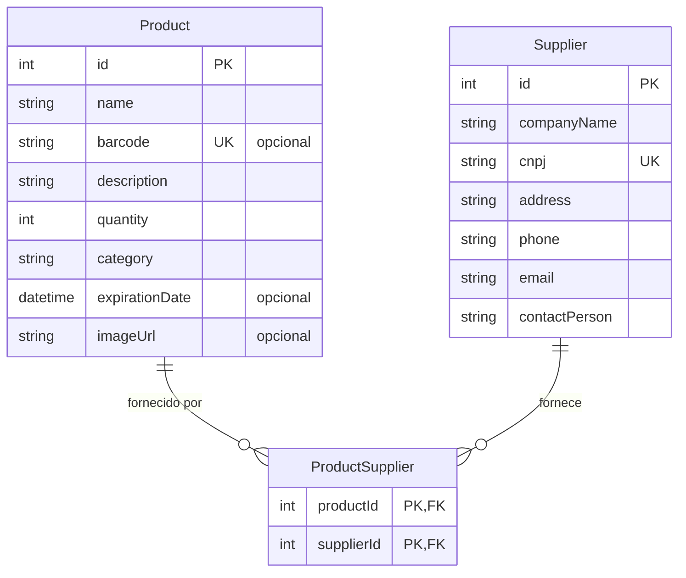

# StockFlow

API REST para gestão de estoque e fornecedores, desenvolvida no Projeto Integrador Full Stack.


## Funcionalidades

- **Produtos:** cadastro, consulta, atualização e remoção, com código de barras único, categoria, quantidade em estoque, validade e imagem.
- **Fornecedores:** cadastro, consulta, atualização e remoção, com CNPJ único.
- **Produtos × fornecedores:** um produto pode ter vários fornecedores e um fornecedor pode atender vários produtos. A API lista os fornecedores de cada produto e os produtos de cada fornecedor.
- **Erros claros:** mensagens em português, com `400` para dados duplicados ou inválidos e `404` para registros inexistentes.

## Modelo de dados



## Estrutura

```
backend/
├── prisma/
│   ├── schema.prisma      # modelos Product, Supplier e ProductSupplier
│   └── migrations/
└── src/
    ├── server.js          # app Express e registro das rotas
    ├── config/prisma.js   # instância única do Prisma Client
    ├── routes/            # definição dos endpoints
    └── controllers/       # regras de negócio e tratamento de erros
```

## Como rodar

Requisito: Node.js 18.18 ou superior.

```bash
cd backend
npm install
echo 'DATABASE_URL="file:./dev.db"' > .env
npx prisma migrate deploy   # cria o banco SQLite em prisma/dev.db
npx prisma generate
npm run dev
```

A API sobe em `http://localhost:3000`.

## Endpoints

| Método | Rota | Descrição |
|---|---|---|
| `GET` | `/` | Status da API |
| `GET` | `/products` | Lista os produtos |
| `GET` | `/products/:id` | Busca um produto |
| `POST` | `/products` | Cadastra um produto |
| `PUT` | `/products/:id` | Atualiza um produto |
| `DELETE` | `/products/:id` | Remove um produto |
| `GET` | `/products/:id/suppliers` | Lista os fornecedores de um produto |
| `GET` | `/suppliers` | Lista os fornecedores |
| `GET` | `/suppliers/:id` | Busca um fornecedor |
| `POST` | `/suppliers` | Cadastra um fornecedor |
| `PUT` | `/suppliers/:id` | Atualiza um fornecedor |
| `DELETE` | `/suppliers/:id` | Remove um fornecedor |
| `GET` | `/suppliers/:id/products` | Lista os produtos de um fornecedor |
| `POST` | `/product-suppliers` | Associa um produto a um fornecedor |
| `DELETE` | `/product-suppliers` | Remove a associação |

As rotas de `/product-suppliers` recebem `productId` e `supplierId` no corpo da requisição.

### Exemplo

```bash
curl -X POST http://localhost:3000/products \
  -H "Content-Type: application/json" \
  -d '{"name":"Teclado USB","barcode":"7890000000001","description":"Teclado ABNT2","quantity":10,"category":"Periféricos"}'
```

## Licença

Distribuído sob a [licença MIT](LICENSE).
